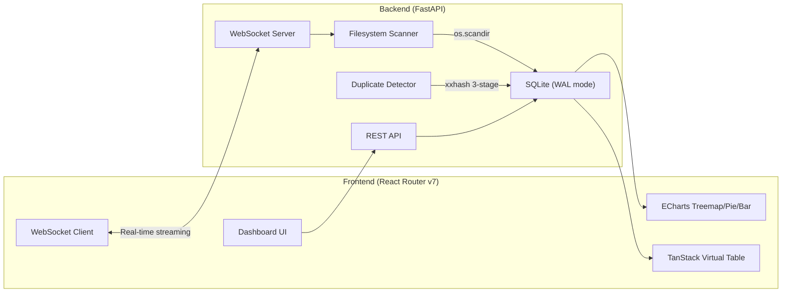

# DiskViz — Windows Disk Usage Visualization Tool

A real-time disk storage analyzer for Windows with an interactive treemap, charts, duplicate detection, and file analysis. Think WinDirStat meets a modern web dashboard.

## Architecture Overview



## Tech Stack

| Layer | Technology | Why |
|:---|:---|:---|
| **Backend** | FastAPI + Uvicorn | Async WebSocket support, high throughput |
| **Filesystem Scan** | `os.scandir()` (stdlib) | 7–20x faster than listdir+stat on Windows, zero extra syscalls |
| **Metadata Store** | SQLite (WAL mode) | Fixed ~50MB RAM for millions of files, instant group-by queries |
| **Hashing** | `xxhash` (xxh3_64) | 15 GB/s non-crypto hash, perfect for duplicate detection |
| **Serialization** | `orjson` | 5–10x faster JSON than stdlib |
| **Frontend** | React Router v7 (framework mode, SPA) | Remix successor, file-based routing, modern React 19 |
| **Styling** | Tailwind CSS v4 + shadcn/ui | Clean, modern component library |
| **Treemap / Charts** | Apache ECharts | Canvas-based, handles 50k+ nodes at 60 FPS, built-in drilldown |
| **Data Table** | TanStack Table v8 + TanStack Virtual | Virtualized rows (renders ~30 of 100k+), headless, tree subrows |

---

## Project Structure

```
d:\Projects\Memory Management\
├── backend/
│   ├── pyproject.toml              # Python project config (uv)
│   ├── main.py                     # FastAPI app entry point
│   ├── config.py                   # Settings & configuration
│   ├── database.py                 # SQLite connection & schema
│   ├── scanner/
│   │   ├── __init__.py
│   │   ├── filesystem.py           # os.scandir-based traversal
│   │   └── hasher.py               # 3-stage duplicate detection
│   ├── routers/
│   │   ├── __init__.py
│   │   ├── drives.py               # GET /api/drives (list drives)
│   │   ├── scans.py                # REST CRUD for scan sessions
│   │   ├── analysis.py             # GET /api/scans/:id/stats, /treemap, /extensions, /large-files, /old-files
│   │   ├── duplicates.py           # GET /api/scans/:id/duplicates
│   │   └── export.py               # GET /api/scans/:id/export/csv|json
│   ├── ws/
│   │   ├── __init__.py
│   │   └── scan_ws.py              # WebSocket /ws/scan — real-time streaming
│   └── models.py                   # Pydantic schemas
│
├── frontend/
│   ├── package.json
│   ├── vite.config.ts
│   ├── react-router.config.ts      # SPA mode (ssr: false)
│   ├── tsconfig.json
│   ├── components.json             # shadcn/ui config
│   ├── app/
│   │   ├── root.tsx                # HTML shell, WebSocket provider
│   │   ├── app.css                 # Tailwind v4 import + shadcn theme
│   │   ├── routes.ts               # Route definitions
│   │   ├── routes/
│   │   │   ├── home.tsx            # Dashboard — drive list, recent scans
│   │   │   ├── scan.tsx            # Active scan — real-time treemap + progress
│   │   │   ├── results.tsx         # Layout wrapper for scan results
│   │   │   ├── results.overview.tsx    # Treemap + extension pie + summary cards
│   │   │   ├── results.files.tsx       # Virtual file table with sort/filter
│   │   │   ├── results.duplicates.tsx  # Duplicate file groups
│   │   │   └── results.large-files.tsx # Top N largest files bar chart
│   │   ├── components/
│   │   │   ├── ui/                 # shadcn/ui components (button, card, etc.)
│   │   │   ├── treemap-chart.tsx   # ECharts treemap wrapper
│   │   │   ├── extension-pie.tsx   # ECharts donut chart
│   │   │   ├── size-bar-chart.tsx  # ECharts horizontal bar chart
│   │   │   ├── file-table.tsx      # TanStack Table + Virtual
│   │   │   ├── drive-picker.tsx    # Drive/folder selector
│   │   │   ├── scan-progress.tsx   # Real-time scan progress overlay
│   │   │   └── stat-card.tsx       # Summary metric card
│   │   ├── context/
│   │   │   └── scan-context.tsx    # WebSocket connection + scan state
│   │   ├── hooks/
│   │   │   ├── use-echarts.ts      # Reusable ECharts hook (init/resize/dispose)
│   │   │   └── use-scan.ts         # Scan WebSocket hook
│   │   └── lib/
│   │       ├── api.ts              # REST API client (fetch wrappers)
│   │       ├── format.ts           # Byte formatting, date formatting
│   │       └── utils.ts            # shadcn cn() utility
│   └── public/
│       └── favicon.ico
│
└── README.md
```

---

## Proposed Changes

### Backend — Core Infrastructure

#### [NEW] [pyproject.toml](file:///d:/Projects/Memory%20Management/backend/pyproject.toml)
Python project managed with `uv`. Dependencies:
- `fastapi`, `uvicorn[standard]`, `orjson`, `xxhash`, `aiofiles`
- Dev: `ruff`, `pytest`

#### [NEW] [main.py](file:///d:/Projects/Memory%20Management/backend/main.py)
FastAPI application entry point:
- CORS middleware (allow `localhost:5173` for Vite dev server)
- Mount all routers under `/api/`
- Mount WebSocket at `/ws/scan`
- Lifespan handler to initialize/close SQLite on startup/shutdown

#### [NEW] [config.py](file:///d:/Projects/Memory%20Management/backend/config.py)
- `DB_PATH` — SQLite database file location (default: `./diskviz.db`)
- `SCAN_BATCH_SIZE` — items per WebSocket message (default: 200)
- `SCAN_FLUSH_INTERVAL` — max seconds between flushes (default: 0.1)
- `HASH_CHUNK_SIZE` — bytes per hash chunk (default: 64KB)

#### [NEW] [database.py](file:///d:/Projects/Memory%20Management/backend/database.py)
SQLite setup with WAL mode and performance pragmas:
```sql
CREATE TABLE IF NOT EXISTS scans (
    id TEXT PRIMARY KEY,
    root_path TEXT NOT NULL,
    status TEXT DEFAULT 'pending',  -- pending|scanning|analyzing|done|cancelled
    total_files INTEGER DEFAULT 0,
    total_size INTEGER DEFAULT 0,
    started_at TEXT,
    completed_at TEXT
);

CREATE TABLE IF NOT EXISTS files (
    id INTEGER PRIMARY KEY AUTOINCREMENT,
    scan_id TEXT NOT NULL,
    path TEXT NOT NULL,
    name TEXT NOT NULL,
    extension TEXT,
    size INTEGER NOT NULL,
    mtime REAL,
    parent_dir TEXT,
    depth INTEGER,
    partial_hash TEXT,
    full_hash TEXT,
    FOREIGN KEY (scan_id) REFERENCES scans(id)
);

CREATE INDEX idx_files_scan_id ON files(scan_id);
CREATE INDEX idx_files_size ON files(scan_id, size);
CREATE INDEX idx_files_extension ON files(scan_id, extension);
CREATE INDEX idx_files_parent ON files(scan_id, parent_dir);
```

---

### Backend — Filesystem Scanner

#### [NEW] [scanner/filesystem.py](file:///d:/Projects/Memory%20Management/backend/scanner/filesystem.py)
High-performance iterative scanner using `os.scandir()`:
- `\\?\` long-path prefix for Windows
- `follow_symlinks=False` to avoid junction loops
- Iterative stack-based traversal (no recursion limit issues)
- `threading.Event` for cancellation
- Yields `FileEntry` dicts with path, name, extension, size, mtime, parent_dir, depth

#### [NEW] [scanner/hasher.py](file:///d:/Projects/Memory%20Management/backend/scanner/hasher.py)
3-stage duplicate detection pipeline:
1. **Size grouping** — SQL `GROUP BY size HAVING COUNT(*) > 1` (zero I/O)
2. **Partial hash** — Read first 64KB, `xxh3_64` hash, group again
3. **Full hash** — Full file `xxh3_64` hash for remaining candidates

Each stage streams progress via callback for WebSocket updates.

---

### Backend — REST API Routers

#### [NEW] [routers/drives.py](file:///d:/Projects/Memory%20Management/backend/routers/drives.py)
- `GET /api/drives` — List available Windows drives with total/free space (`shutil.disk_usage`)
- `GET /api/browse?path=` — Browse directory tree for folder picker

#### [NEW] [routers/scans.py](file:///d:/Projects/Memory%20Management/backend/routers/scans.py)
- `GET /api/scans` — List all scan sessions
- `GET /api/scans/:id` — Get scan metadata and status
- `DELETE /api/scans/:id` — Delete scan and its file records

#### [NEW] [routers/analysis.py](file:///d:/Projects/Memory%20Management/backend/routers/analysis.py)
- `GET /api/scans/:id/treemap?depth=3` — Hierarchical treemap data (directories with aggregated sizes, limited to N levels for performance)
- `GET /api/scans/:id/extensions` — Extension breakdown (extension, count, total_size) sorted by size
- `GET /api/scans/:id/large-files?limit=100` — Top N largest files
- `GET /api/scans/:id/old-files?days=365` — Files not modified in N days
- `GET /api/scans/:id/stats` — Summary stats (total files, total size, avg file size, extension count, oldest/newest file)

#### [NEW] [routers/duplicates.py](file:///d:/Projects/Memory%20Management/backend/routers/duplicates.py)
- `POST /api/scans/:id/duplicates/start` — Kick off duplicate detection (runs in background thread)
- `GET /api/scans/:id/duplicates` — Get duplicate groups (grouped by hash, with file list and wasted space)
- `GET /api/scans/:id/duplicates/stats` — Summary: total duplicate groups, total wasted bytes

#### [NEW] [routers/export.py](file:///d:/Projects/Memory%20Management/backend/routers/export.py)
- `GET /api/scans/:id/export/csv` — Streaming CSV export via `StreamingResponse`
- `GET /api/scans/:id/export/json` — Streaming NDJSON export

---

### Backend — WebSocket

#### [NEW] [ws/scan_ws.py](file:///d:/Projects/Memory%20Management/backend/ws/scan_ws.py)
`/ws/scan` — Real-time scan streaming:
1. Client connects and sends `{ "path": "D:\\" }`
2. Backend spawns scanner in background thread
3. Batches of 200 files streamed every 100ms via bounded `asyncio.Queue(maxsize=50)`
4. Progress messages: `{ "type": "progress", "scanned": 45000, "size": 123456789 }`
5. Batch messages: `{ "type": "batch", "items": [...] }`
6. Completion: `{ "type": "done", "scan_id": "uuid", "total": 123456 }`
7. Client disconnect → `threading.Event` cancels scan immediately

---

### Frontend — Scaffolding & Config

#### [NEW] React Router v7 project
Scaffolded via `npx create-react-router@latest frontend`

#### [NEW] [react-router.config.ts](file:///d:/Projects/Memory%20Management/frontend/react-router.config.ts)
```typescript
export default { ssr: false } satisfies Config; // SPA mode — no SSR needed
```

#### [NEW] [vite.config.ts](file:///d:/Projects/Memory%20Management/frontend/vite.config.ts)
- `@react-router/dev/vite` plugin
- `@tailwindcss/vite` plugin
- Proxy `/api` and `/ws` to `localhost:8000` (FastAPI backend)

---

### Frontend — Core Layout & Routing

#### [NEW] [app/routes.ts](file:///d:/Projects/Memory%20Management/frontend/app/routes.ts)
```typescript
export default [
  index("./routes/home.tsx"),                           // /
  route("scan", "./routes/scan.tsx"),                   // /scan (active scan)
  layout("./routes/results.tsx", [                      // /results/:id/*
    route("results/:id", "./routes/results.overview.tsx"),
    route("results/:id/files", "./routes/results.files.tsx"),
    route("results/:id/duplicates", "./routes/results.duplicates.tsx"),
    route("results/:id/large-files", "./routes/results.large-files.tsx"),
  ]),
] satisfies RouteConfig;
```

#### [NEW] [app/root.tsx](file:///d:/Projects/Memory%20Management/frontend/app/root.tsx)
- HTML shell with dark/light mode support
- Global `<ScanProvider>` context (WebSocket state management)
- Top navigation bar with app logo and theme toggle
- `<Outlet />` for page content

---

### Frontend — Dashboard (Home)

#### [NEW] [routes/home.tsx](file:///d:/Projects/Memory%20Management/frontend/app/routes/home.tsx)
- **Drive Cards**: List all drives with usage bar (used/free/total), powered by `GET /api/drives`
- **Quick Scan**: Click a drive or "Browse..." button to pick a folder and start scanning
- **Recent Scans**: Table of past scan sessions with status, date, and "View Results" link
- Uses shadcn `Card`, `Button`, `Progress` components

---

### Frontend — Active Scan View

#### [NEW] [routes/scan.tsx](file:///d:/Projects/Memory%20Management/frontend/app/routes/scan.tsx)
The real-time scanning experience:
- **Progress Header**: Files scanned counter, total size counter, elapsed time (animated)
- **Live Treemap**: ECharts treemap that rebuilds every ~2 seconds as data streams in
- **Live Extension Breakdown**: Donut chart updating in real-time
- **File Stream**: Scrolling list of recently scanned files (last 50)
- **Cancel Button**: Sends cancel signal, aborts scan gracefully
- When scan completes → auto-navigate to `/results/:id`

---

### Frontend — Results Views

#### [NEW] [routes/results.tsx](file:///d:/Projects/Memory%20Management/frontend/app/routes/results.tsx)
Layout wrapper with:
- **Sidebar/Tab Navigation**: Overview | Files | Duplicates | Large Files
- **Scan Header**: Root path, total files, total size, scan duration
- **Export Buttons**: CSV / JSON download
- `<Outlet />` for child routes

#### [NEW] [routes/results.overview.tsx](file:///d:/Projects/Memory%20Management/frontend/app/routes/results.overview.tsx)
- **Summary Cards**: Total files, total size, unique extensions, avg file size, oldest file
- **Interactive Treemap**: Full ECharts treemap with drill-down (click folder to zoom in), breadcrumb navigation, tooltip showing folder name + size + file count
- **Extension Breakdown**: Donut chart showing top 15 extensions by size, with "Other" bucket
- **Directory Size Bar Chart**: Top 20 largest directories

#### [NEW] [routes/results.files.tsx](file:///d:/Projects/Memory%20Management/frontend/app/routes/results.files.tsx)
- **Virtualized File Table** (TanStack Table + Virtual):
  - Columns: Name, Path, Extension, Size, Modified Date
  - Sortable by any column
  - Filterable by extension dropdown, name search, size range
  - Expandable tree rows (folders → files)
  - Pagination/infinite scroll for 100k+ rows

#### [NEW] [routes/results.duplicates.tsx](file:///d:/Projects/Memory%20Management/frontend/app/routes/results.duplicates.tsx)
- **"Start Detection" button** if not yet run
- **Progress bar** during detection (WebSocket updates)
- **Duplicate Groups Table**: Grouped by hash, showing file count, size per file, total wasted space
- Expandable rows showing all file paths in each group
- Summary: "X duplicate groups found, Y GB of wasted space"

#### [NEW] [routes/results.large-files.tsx](file:///d:/Projects/Memory%20Management/frontend/app/routes/results.large-files.tsx)
- **Top 100 Largest Files**: Horizontal bar chart (ECharts)
- **File Age Scatter**: Files plotted by size vs. last modified date
- **Old Files Section**: Files not modified in 1+ year, sortable table

---

### Frontend — Shared Components

#### [NEW] [components/treemap-chart.tsx](file:///d:/Projects/Memory%20Management/frontend/app/components/treemap-chart.tsx)
ECharts treemap with:
- `leafDepth: 1` for drill-down by click
- Breadcrumb navigation bar
- Color by extension type or depth
- Formatted byte tooltips
- Responsive resize via `ResizeObserver`

#### [NEW] [components/extension-pie.tsx](file:///d:/Projects/Memory%20Management/frontend/app/components/extension-pie.tsx)
ECharts donut showing extension breakdown. Click a slice to filter the treemap.

#### [NEW] [components/size-bar-chart.tsx](file:///d:/Projects/Memory%20Management/frontend/app/components/size-bar-chart.tsx)
ECharts horizontal bar for top directories / top files.

#### [NEW] [components/file-table.tsx](file:///d:/Projects/Memory%20Management/frontend/app/components/file-table.tsx)
TanStack Table with virtual scrolling, multi-column sort, extension filter, name search. Headless + shadcn/ui `Table` styling.

#### [NEW] [components/drive-picker.tsx](file:///d:/Projects/Memory%20Management/frontend/app/components/drive-picker.tsx)
Drive selector + folder browser dialog for choosing scan targets.

#### [NEW] [components/scan-progress.tsx](file:///d:/Projects/Memory%20Management/frontend/app/components/scan-progress.tsx)
Animated progress overlay: file counter, size counter, elapsed time, cancel button.

#### [NEW] [components/stat-card.tsx](file:///d:/Projects/Memory%20Management/frontend/app/components/stat-card.tsx)
Reusable metric card (icon + label + value + optional trend).

---

### Frontend — Context & Hooks

#### [NEW] [context/scan-context.tsx](file:///d:/Projects/Memory%20Management/frontend/app/context/scan-context.tsx)
React Context + WebSocket management:
- Connects to `/ws/scan` only when a scan is active
- Accumulates streamed file data into state
- Exposes: `startScan(path)`, `cancelScan()`, `scanStatus`, `scanData`, `progress`
- Auto-reconnect on disconnect
- Cleans up WebSocket on unmount

#### [NEW] [hooks/use-echarts.ts](file:///d:/Projects/Memory%20Management/frontend/app/hooks/use-echarts.ts)
Reusable hook: `useECharts(containerRef, options)` — handles init, setOption, resize, dispose lifecycle.

#### [NEW] [hooks/use-scan.ts](file:///d:/Projects/Memory%20Management/frontend/app/hooks/use-scan.ts)
Convenience hook wrapping `ScanContext` for components.

---

## User Review Required

> [!IMPORTANT]
> **SPA Mode**: Since this is a local development tool (backend and frontend on the same machine), I'm proposing **SPA mode** (`ssr: false`) for React Router v7. This avoids Node.js SSR complexity — the Vite dev server just serves static files and proxies API calls to FastAPI. For production, you'd build static assets and serve them from FastAPI or a simple file server. Does this approach work for you?

> [!IMPORTANT]  
> **Database Persistence**: Scan results will be stored in a SQLite file (`diskviz.db`) so you can revisit past scans without re-scanning. The DB file will live alongside the backend. Is that acceptable, or would you prefer in-memory only (results lost on restart)?

> [!IMPORTANT]
> **Dark Mode Default**: The UI will support both light and dark modes via shadcn/ui theming. Should **dark mode be the default** (common for dev tools)?

---

## Open Questions

> [!NOTE]
> **File Operations**: Should the tool support any file operations (delete, move, open in Explorer) from the UI? Or is it strictly read-only / analysis-only for now?

> [!NOTE]
> **PDF Export**: You selected "Export reports (CSV/JSON/PDF)". PDF generation adds significant complexity (a rendering library like `reportlab` or `weasyprint`). Should I include PDF export in v1, or defer it to a later iteration?

---

## Verification Plan

### Automated Tests
```bash
# Backend unit tests
cd backend && uv run pytest tests/ -v

# Frontend type checking
cd frontend && npx tsc --noEmit

# Frontend dev server
cd frontend && npm run dev
```

### Manual Verification
1. Start backend: `cd backend && uv run uvicorn main:app --reload --port 8000`
2. Start frontend: `cd frontend && npm run dev` (Vite on port 5173)
3. **Drive listing**: Verify all Windows drives appear on the dashboard
4. **Live scan**: Pick a small folder (~1000 files), verify real-time treemap updates and progress counter
5. **Large scan**: Scan `C:\Users` or a large directory, verify no crashes, reasonable memory usage
6. **Treemap drill-down**: Click folders to zoom in, verify breadcrumb navigation
7. **Extension chart**: Verify donut chart shows correct extension breakdown
8. **File table**: Sort by size, filter by extension, verify virtual scrolling is smooth
9. **Duplicate detection**: Run on a folder with known duplicates, verify correct grouping
10. **Export**: Download CSV and JSON, verify contents match scan data
11. **Cancel scan**: Start a large scan, cancel mid-way, verify scan stops and partial results are available
